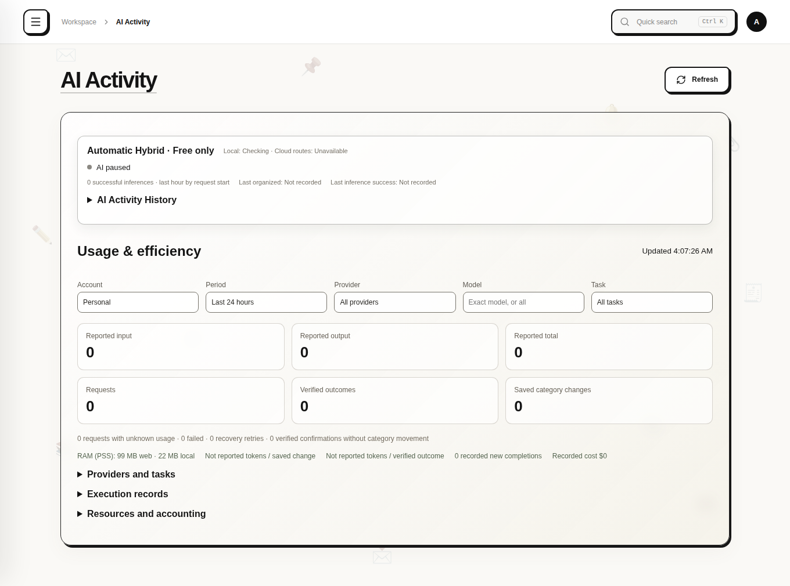
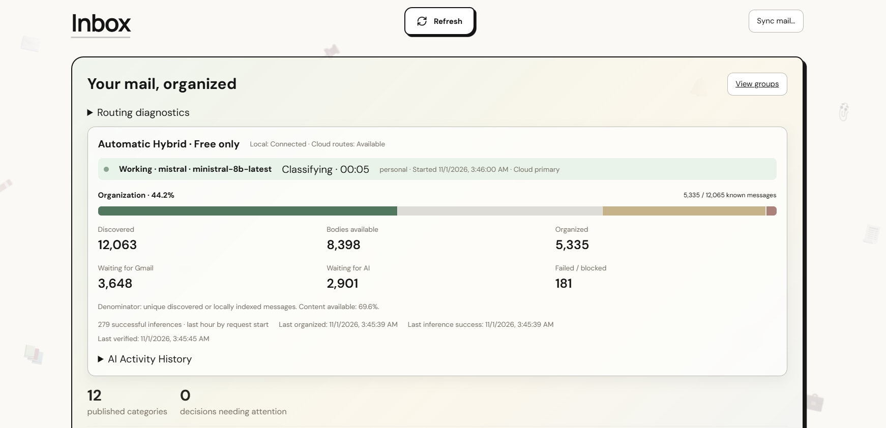
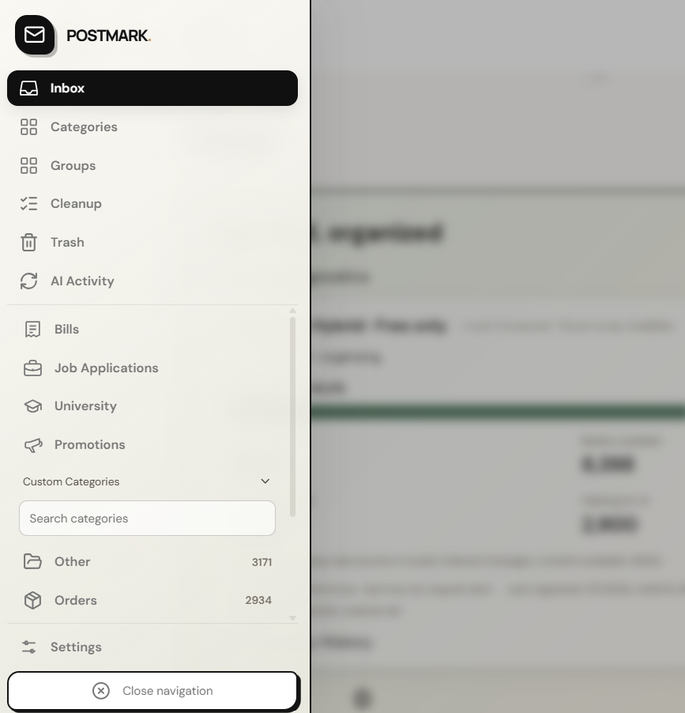
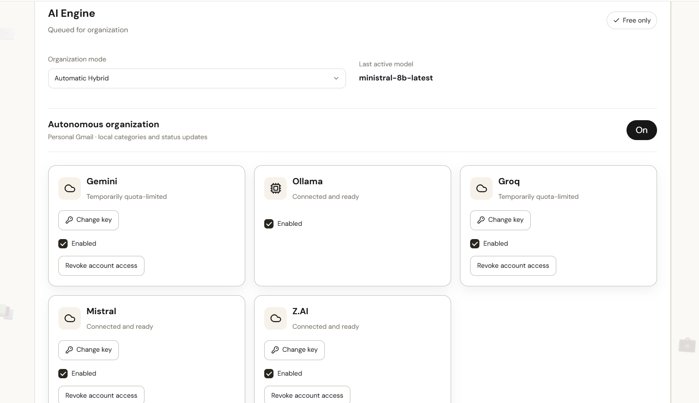
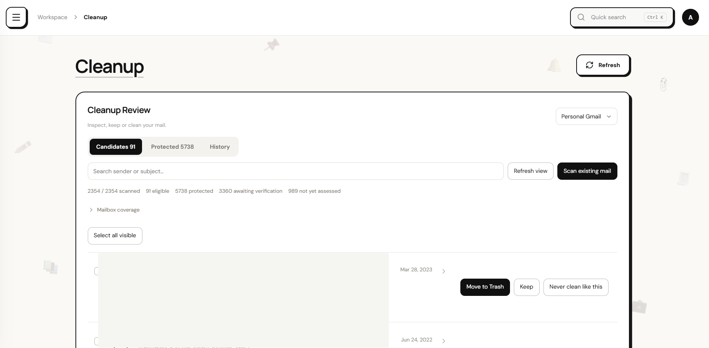
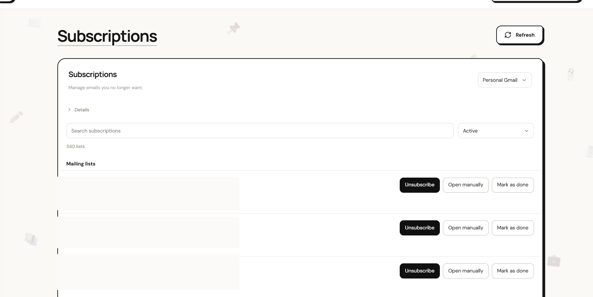
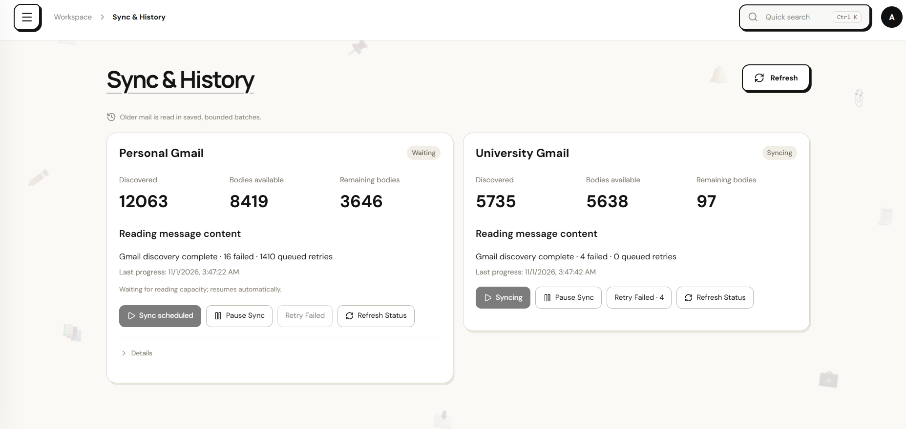

# Postmark

**Autonomous Multilingual AI Email Organizer · Work in Progress**

Postmark is a self-hosted email organization project combining local-first data processing, a multi-provider AI engine, and recoverable automation. It is being developed to understand and organize messages in **Arabic, Hebrew and English** without turning every email subtype into a separate folder.

> **Status — Work in Progress (November 2026).** Postmark is under active development. It is not presented as production-hardened, externally audited, or ready for third-party deployment.

## Highlights

- **Autonomous organization:** identifies meaningful local categories, reuses existing categories when appropriate, selects relevant icons, and publishes with an audit/rollback trail.
- **Multilingual understanding:** category, document subtype and workflow status are represented separately.
- **Multi-model routing:** Gemini, Groq, Mistral, Z.AI, and local Ollama, respecting actual per-model capabilities, account permissions and rate limits.
- **Privacy-conscious accounts:** separate personal and university account scopes; cloud AI access is provider-specific.
- **Durable background work:** Gmail sync, queued classification, retry/cooldown, crash recovery, idempotent operations, and SQLite WAL.
- **Cleanup and safety:** review, grouping, batch trash/restore, and additional authorization before irreversible deletion.
- **Observability:** real inference activity, queues, token usage, and resource diagnostics.

## Technology

| Layer | Technology |
|---|---|
| Backend | Python, FastAPI |
| Persistence | SQLite with WAL, durable job records |
| Frontend | React, TypeScript, Vite |
| AI | Provider-aware cloud inference + local Ollama |
| Email integration | Gmail API |
| Development | Ubuntu / WSL2, Git |

## Architecture

```text
Gmail accounts
     |
     v
Discovery / sync / body backfill
     |
     v
Durable task queue & scheduler
     |
     v
Account-aware, free-only AI router
     |---- qualified cloud models
     \---- Ollama local inference
     |
     v
Semantic results (category / subtype / status)
     |
     v
Atomic taxonomy publication + reversible audit
     |
     v
FastAPI -> React dashboard
```

## Real application screenshots

The image below is the actual React application running against a fresh, isolated empty database. It contains no connected mailbox, private messages or model credentials; it is not evidence of live cloud inference. No AI-generated mockup was used.



## Engineering work

Postmark has involved solving real issues such as SQLite locking, long-running task recovery, model-provider cooldowns, prompt duplication, RAM pressure from local inference, and autonomous taxonomy publication without category proliferation.

## Current limitations

- Multilingual classification and some document subtypes still need more human-verified accuracy evaluation.
- Free inference quotas limit throughput; provider availability is not guaranteed.
- Token use, local inference memory and end-to-end unattended reliability continue to be optimized.
- Packaging, security review and external installation instructions are not complete.

## Security & privacy

This repository now contains the reviewed application source, synthetic tests and configuration templates. Live credentials, mailbox data, local runtime history and production screenshots are excluded. Source publication does not make the application production-hardened.

Do not commit API keys, OAuth tokens, email bodies, user databases, logs, exported credentials, or screenshots containing private messages. The release tree and its separate publication history were scanned before publication. See [Setup](docs/SETUP.md) and [Publication verification](docs/PUBLICATION.md).

## Run locally

See [installation and account setup](docs/SETUP.md). The server is loopback-only; do not expose it directly to the LAN or Internet. A fresh installation contains no account tokens, provider keys, qualified-model evidence or production permissions.

```bash
python3 -m venv .venv
.venv/bin/python -m pip install -r requirements.txt
npm ci --prefix frontend
npm run build --prefix frontend
cp .env.example .env
PYTHONPATH=src .venv/bin/uvicorn email_agent.api.app:app --host 127.0.0.1 --port 8000 --env-file .env
```

## Development status

🚧 **Active development / Work in Progress.** The goal is a reliable autonomous email agent that organizes messages without routine user decisions while keeping irreversible mail actions behind explicit permissions.

---
Built as a hands-on software engineering project.## Real application screenshots

All images below are real captures from the Postmark application, with sender details redacted where necessary. They are not mockups or AI-generated screenshots.

### 1. Live inbox and autonomous organization



### 2. Navigation and organized categories



### 3. AI engine and model routing



### 4. Cleanup workflow



### 5. Subscription management



### 6. Background sync and history


